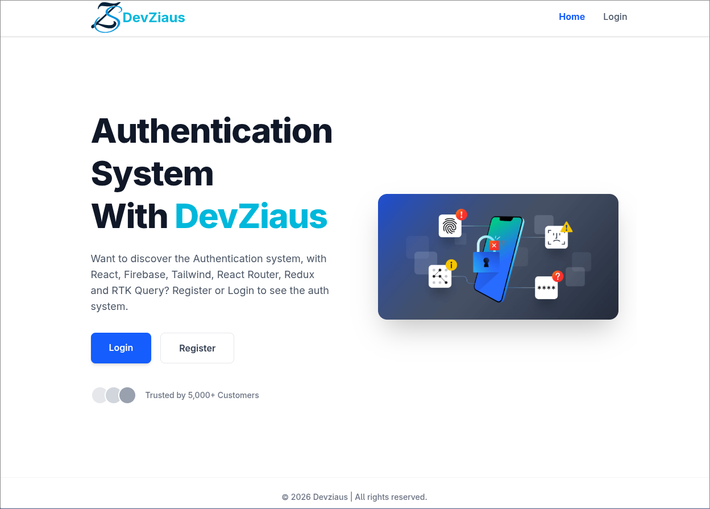

# 🔐 React Firebase Authentication & RBAC Starter



A production-ready Authentication System built with React 18, Redux Toolkit, and Firebase. This project serves as a robust foundation for any application requiring secure user login, social authentication, and **Role-Based Access Control (RBAC)**.

It features a complete flow for **Admins** vs. **Standard Users**, including protected routes, persistent sessions, and a dynamic dashboard layout.

## ✨ Key Features

- **Multi-Method Authentication:**
    - Email & Password Login/Signup
    - Google OAuth Integration
    - GitHub OAuth Integration
- **Role-Based Access Control (RBAC):**
    - Custom `admin` and `user` roles stored in Firestore.
    - **Protected Routes:** middleware that redirects unauthorized users.
    - **Dynamic Sidebar:** Menu items hide/show based on the logged-in user's role.
- **Persistent Sessions:** A global `AuthListener` ensures users stay logged in across page reloads without flashing the login screen.
- **User Profile Management:** Read-only profile display fetching real-time data from Firestore.
- **Modern UI:** Built with Tailwind CSS, featuring mobile-responsive sidebars and loading states.

## 🛠️ Tech Stack

- **Frontend:** React 18 (Vite)
- **State Management:** Redux Toolkit (RTK)
- **Routing:** React Router v7
- **Backend-as-a-Service:** Firebase (Auth + Firestore)
- **Styling:** Tailwind CSS

---

## 🔥 Firebase Configuration Setup (Step-by-Step)

To run this project, you must set up a Firebase project. Follow these steps strictly:

### 1. Create Project

1.  Go to the [Firebase Console](https://console.firebase.google.com/).
2.  Click **"Add project"** and give it a name (e.g., `auth-dashboard-demo`).
3.  Disable Google Analytics (optional) and create the project.

### 2. Enable Authentication

1.  Navigate to **Build > Authentication** in the sidebar.
2.  Click **"Get Started"**.
3.  **Sign-in method** tab:
    - Enable **Email/Password**.
    - Enable **Google** (Save).
    - Enable **GitHub** (You will need to register a generic OAuth app in GitHub settings to get the _Client ID_ and _Secret_).

### 3. Setup Firestore Database

1.  Navigate to **Build > Firestore Database**.
2.  Click **"Create Database"**.
3.  Select a location close to you.
4.  **Start in Production Mode**.

### 4. Update Firestore Security Rules

**Crucial:** To allow users to write their own data but block strangers, go to the **Rules** tab in Firestore and paste this:

```javascript
rules_version = '2';
service cloud.firestore {
  match /databases/{database}/documents {

    // Allow users to read/write ONLY their own document
    match /users/{userId} {
      allow read, write: if request.auth != null && request.auth.uid == userId;
    }

    // Default: Deny everything else
    match /{document=**} {
      allow read, write: if false;
    }
  }
}

```

### 5. Get API Keys

1. Click the **Gear Icon (Settings)** > **Project settings**.
2. Scroll down to "Your apps" and click the **</> (Web)** icon.
3. Register the app (e.g., `React App`).
4. Copy the `firebaseConfig` object (keys, domains, etc.). You will need these for the next step.

---

## 🚀 Installation & Running

1. **Clone the repository**

```sh
git clone [https://github.com/your-username/react-firebase-rbac.git](https://github.com/your-username/react-firebase-rbac.git)
```

2. Change Directory

```sh
cd react-firebase-rbac
```

3. **Install dependencies**

```sh
npm install

```

4. **Configure Environment Variables**
   Create a `.env` (or `.env.local`) file in the root directory. Paste your Firebase keys here:

```env
#FIREBASE
VITE_FIREBASE_API_KEY=YOUR_FIREBASE_API_KEY,
VITE_FIREBASE_AUTH_DOMAIN=YOUR_FIREBASE_AUTH_DOMAIN,
VITE_FIREBASE_PROJECT_ID=YOUR_FIREBASE_PROJECT_ID,
VITE_FIREBASE_STORAGE_BUCKET=YOUR_FIREBASE_STORAGE_BUCKET,
VITE_FIREBASE_MESSAGING_SENDER_ID=YOUR_FIREBASE_MESSAGING_SENDER_ID,
VITE_FIREBASE_APP_ID=YOUR_FIREBASE_APP_ID,

```

5. **Run the application**

```sh
npm run dev

```

## 📂 Project Structure

```text
src/
├── components/         # UI Components (Sidebar, Navbar, Loader)
├── config/             # Firebase initialization
├── features/           # Redux Slices (authSlice)
├── hooks/              # Custom Hooks (useAuth)
├── layouts/            # Layout Wrappers (DashboardLayout)
├── pages/              # Views (Login, Signup, Profile, Dashboard)
├── router/              # React Router Setup
├── store/              # Redux store
└── index.css           # tailwind css
└── main.jsx            # Entry point
└── .env                # Environment Variable
└── .env.example                # Example Environment Variable

```

## 👨‍💻 Author

**DevZiaus**

- GitHub: [@DevZiaus](https://github.com/DevZiaus)
- LinkedIn: [LinkedInd](https://www.linkedin.com/in/devziaus)

---

_This project is for educational purposes and is open source._
